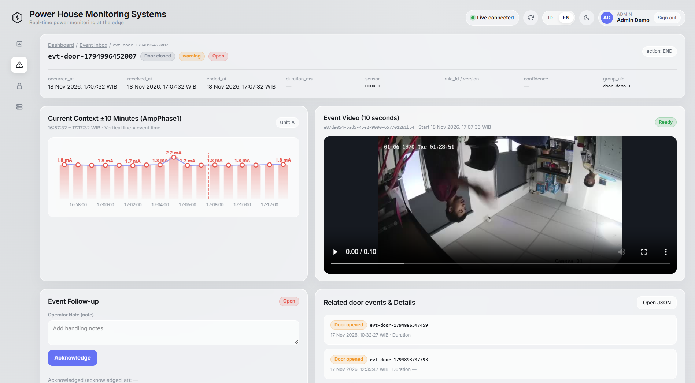

# Power House Monitoring Systems

Real-time power monitoring at the edge.


Aplikasi monitoring arus dan event untuk satu gardu PLN. Stack mengikuti [PRD.md](./PRD.md), [ADR.md](./ADR.md), dan [TECH_STACK.md](./TECH_STACK.md).

<p align="center">
  <a href="./docs/screen-capture/screen-1.png"></a>
  <a href="./docs/screen-capture/screen-2.png"></a>
</p>
<p align="center">
  <a href="./docs/screen-capture/screen-3.png"></a>
  <a href="./docs/screen-capture/screen-4.png"></a>
</p>

## Status

Demo single gardu sudah lengkap:

- Login admin dengan session cookie dan proteksi halaman.
- Ingest telemetry, event anomali/door, dan heartbeat via API edge dengan bearer token.
- Dashboard live (SSE), histori arus, inbox event, event detail, dan door log.
- Upload video multipart presigned ke RustFS, validasi SHA-256/ffprobe, playback, dan thumbnail.
- Retensi otomatis, disk guard, status device, audit log, dan simulasi API-driven.

Kontrak edge, idempotensi, status event, dan error/retry ada di [docs/edge-api.md](./docs/edge-api.md).

## Kebutuhan

- Node.js 22+
- corepack
- Docker Engine + Compose plugin
- FFmpeg/ffprobe

## Setup

```bash
corepack enable
cp .env.example .env
mkdir -p data/rustfs data/rustfs-logs
docker compose up -d db rustfs
pnpm install
pnpm db:generate
pnpm db:migrate
pnpm storage:init
pnpm seed
pnpm dev
```

RustFS berjalan sebagai UID `1000` (user `pi`), jadi direktori `data/rustfs` dan `data/rustfs-logs` harus dapat ditulis oleh UID tersebut. Isi `EDGE_TOKEN` dengan `em_` diikuti 64 karakter hex sebelum menjalankan `pnpm seed`.

- Dashboard: `http://localhost:3000`
- Health check: `http://localhost:3000/api/health`
- RustFS console: `http://localhost:9001/rustfs/console/`
- Login: pakai `ADMIN_EMAIL` dan `ADMIN_PASSWORD` dari `.env`.

## Perintah

```bash
pnpm dev
pnpm build
pnpm preview
pnpm typecheck
pnpm lint
pnpm db:generate
pnpm db:migrate
pnpm db:studio
pnpm storage:init
pnpm seed
pnpm sim
pnpm sim:demo
pnpm sim:drop
```
