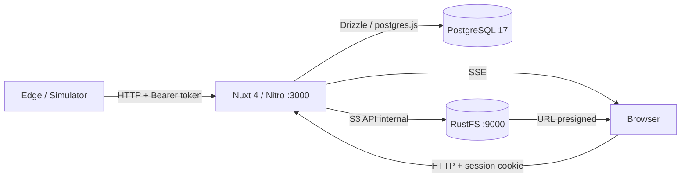

# Power House Monitoring Systems

Real-time power monitoring at the edge.


Aplikasi monitoring arus dan event untuk satu gardu PLN. Stack mengikuti [PRD.md](./PRD.md), [ADR.md](./ADR.md), dan [TECH_STACK.md](./TECH_STACK.md).

<p align="center">
  <a href="./docs/screen-capture/screen-1.png"></a>
  <a href="./docs/screen-capture/screen-2.png"></a>
</p>
<p align="center">
  <a href="./docs/screen-capture/screen-3.png"></a>
  <a href="./docs/screen-capture/screen-4.png"></a>
</p>

## Status

Demo single gardu sudah lengkap:

- Login admin dengan session cookie dan proteksi halaman.
- Ingest telemetry, event anomali/door, dan heartbeat via API edge dengan bearer token.
- Dashboard live (SSE), histori arus, inbox event, event detail, dan door log.
- Upload video multipart presigned ke RustFS, validasi SHA-256/ffprobe, playback, dan thumbnail.
- Retensi otomatis, disk guard, status device, audit log, dan simulasi API-driven.

Kontrak edge, idempotensi, status event, dan error/retry ada di [docs/edge-api.md](./docs/edge-api.md).

## Kebutuhan Sistem

| Dependency | Versi | Fungsi |
|---|---|---|
| Node.js | 22.23.5+ | Runtime Nuxt/Nitro dan script TypeScript |
| corepack + pnpm | pnpm 12.21.0 | Package manager, diaktifkan dengan `corepack enable` |
| Docker Engine + Compose plugin | — | Menjalankan PostgreSQL dan RustFS |
| FFmpeg / ffprobe | 7.1.5+ | Validasi video, pemeriksaan codec, dan thumbnail |
| Git | — | Clone repository |

Semua dependency di atas berjalan native di host; hanya database dan object storage yang berjalan di Docker.

---

## Setup

### 1. Clone dan siapkan environment

```bash
git clone https://github.com/Muhammad-Yunus/energy-monitoring.git
cd energy-monitoring
cp .env.example .env
```

Edit `.env` sebelum lanjut. Field yang wajib diperiksa:

| Field | Catatan |
|---|---|
| `POSTGRES_DB`, `POSTGRES_USER`, `POSTGRES_PASSWORD` | Harus konsisten dengan `DATABASE_URL` |
| `SESSION_SECRET` | Minimal 32 karakter acak |
| `ADMIN_EMAIL`, `ADMIN_PASSWORD` | Kredensial login dashboard |
| `EDGE_SERIAL`, `EDGE_TOKEN` | Token device harus berformat `em_` + 64 karakter hex |
| `S3_PUBLIC_ENDPOINT` | Pakai IP LAN yang bisa diakses browser/edge, bukan `127.0.0.1`, agar presigned URL berfungsi dari perangkat lain |
| `NUXT_PUBLIC_APP_URL` | Placeholder URL aplikasi; opsional, belum direferensikan kode |

Contoh membuat token device:

```bash
echo "em_$(openssl rand -hex 64)"
```

Token asli dipakai simulator/edge dan hanya disimpan sebagai hash SHA-256 di database. Jangan commit `.env`.

### 2. Siapkan direktori data

```bash
mkdir -p data/postgres data/rustfs data/rustfs-logs
```

RustFS berjalan sebagai UID `1000`, jadi `data/rustfs` dan `data/rustfs-logs` harus writable oleh UID tersebut:

```bash
sudo chown -R 1000:1000 data/rustfs data/rustfs-logs
```

### 3. Jalankan database dan storage

```bash
docker compose up -d db rustfs
docker compose ps
```

Tunggu sampai healthcheck keduanya `healthy`. RustFS juga bisa dicek dengan:

```bash
curl -fsS http://127.0.0.1:9000/health
```

### 4. Install dependency aplikasi dan siapkan schema

```bash
corepack enable
pnpm install
pnpm db:generate
pnpm db:migrate
pnpm storage:init
pnpm seed
```

Penjelasan singkat:

- `pnpm db:generate` membuat file migrasi dari schema Drizzle.
- `pnpm db:migrate` menerapkan migrasi ke PostgreSQL.
- `pnpm storage:init` membuat bucket private `recordings` di RustFS.
- `pnpm seed` membuat admin, site, device, sensor, dan kamera. Seed **tidak** membuat reading/event; data tersebut masuk lewat API edge atau simulator.

### 5. Jalankan aplikasi

```bash
pnpm dev
```

Untuk mode produksi:

```bash
pnpm build
pnpm preview
```

### 6. Verifikasi demo

- Dashboard: `http://localhost:3000`
- Login: `ADMIN_EMAIL` dan `ADMIN_PASSWORD` dari `.env`
- Health check: `http://localhost:3000/api/health`
- RustFS console: `http://localhost:9001/rustfs/console/`

Untuk menghasilkan data awal, buka dashboard lalu jalankan simulasi:

```bash
pnpm sim:demo
```

Skenario lain: `pnpm sim:drop` (arus turun + pintu), `pnpm sim:surge`, `pnpm sim:door`, `pnpm sim:offline`.

---

## Database

- **PostgreSQL 17** berjalan di Docker, bind ke `127.0.0.1:5432`, data di `data/postgres`.
- Akses data memakai **Drizzle ORM** + `postgres.js`; schema ada di `server/db/schema.ts`, migrasi di `drizzle/`.
- Tabel dibagi menjadi:
  - Master: `sites`, `devices`, `sensors`, `cameras`, `users`.
  - Telemetri dan event: `readings`, `events`, `audit_logs`.
  - Video: `recordings`, `recording_uploads` (hanya metadata dan object key; file video tidak disimpan di database).
- Semua waktu disimpan sebagai `timestamptz` UTC dan ditampilkan dalam `Asia/Jakarta`.
- Idempotensi ingest: `(sensor_id, ts)` untuk `readings` dan `(device_id, event_uid)` untuk `events`.
- Time-series memakai tabel biasa dengan agregasi `date_bin`; tanpa TimescaleDB atau partisi.
- Retensi default: `readings` 30 hari, `events` 90 hari, `audit_logs` 90 hari, `recordings` 7 hari.

Detail schema dan kontrak ada di [TECH_STACK.md](./TECH_STACK.md) dan [docs/ui-data-model.md](./docs/ui-data-model.md).

---

## Storage

- **RustFS 1.0.6** adalah object storage S3-compatible dengan bucket private `recordings`.
- Port `9000` untuk S3 API dan `9001` untuk console.
- Server memakai `S3_INTERNAL_ENDPOINT` (`http://127.0.0.1:9000`) untuk operasi internal; browser/edge menerima URL presigned dari `S3_PUBLIC_ENDPOINT` (IP LAN).
- Upload video memakai **presigned S3 multipart** dengan part 5 MiB, batas 5 MB dan 30 detik per klip.
- Setelah upload selesai, server memvalidasi SHA-256 dan `ffprobe`, lalu membuat thumbnail. Playback/thumbnail memakai redirect 302 ke URL presigned; bucket tidak diakses anonymous.
- Retensi video 7 hari dengan batas total 1,5 GB. Disk guard menolak recording baru dengan HTTP `507` jika free disk di bawah 1 GB.

Alur detail ada di [TECH_STACK.md](./TECH_STACK.md) dan [docs/edge-api.md](./docs/edge-api.md).

---

## Arsitektur



Struktur sumber:

```text
app/              UI Nuxt: pages, components, composables, i18n, styling
server/api/       Endpoint user, edge, auth, dan health
server/db/        Schema Drizzle dan koneksi database
server/utils/     Auth, event bus SSE, S3, retensi, finalisasi video
shared/schemas/   Kontrak Zod bersama untuk payload edge
drizzle/          Migrasi SQL yang di-commit
scripts/          Seed, init storage, dan simulator API
docs/             Dokumentasi API, model data, dan screenshot
```

Aplikasi memakai SSE dengan in-memory event bus (tanpa Redis/WebSocket). Proses async dan scheduled task menangani finalisasi video serta retensi tanpa queue eksternal.

---

## Perintah

```bash
pnpm dev
pnpm build
pnpm preview
pnpm typecheck
pnpm lint
pnpm db:generate
pnpm db:migrate
pnpm db:studio
pnpm storage:init
pnpm seed
pnpm sim
pnpm sim:demo
pnpm sim:drop
pnpm sim:surge
pnpm sim:door
pnpm sim:offline
pnpm video:sample
```
