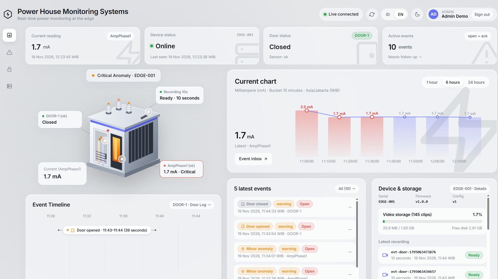
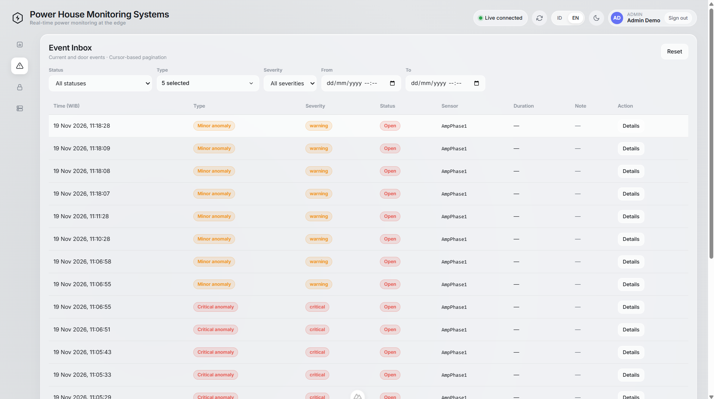
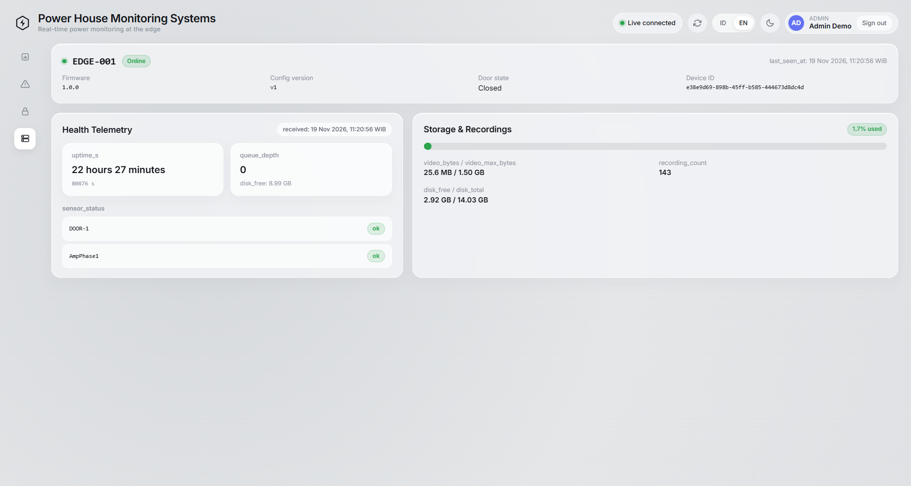

# Power House Monitoring Systems

Real-time power monitoring at the edge.


Current and event monitoring application for a single PLN substation. The stack follows [PRD.md](./PRD.md), [ADR.md](./ADR.md), and [TECH_STACK.md](./TECH_STACK.md).

<p align="center">
  <a href="./docs/screen-capture/screen-1.png"></a>
  <a href="./docs/screen-capture/screen-2.png"></a>
</p>
<p align="center">
  <a href="./docs/screen-capture/screen-3.png"></a>
  <a href="./docs/screen-capture/screen-4.png"></a>
</p>

## Status

The single-substation demo is complete:

- Admin login with session cookies and page protection.
- Ingest telemetry, anomaly/door events, and heartbeats through the edge API with bearer tokens.
- Live dashboard (SSE), current history, event inbox, event details, and door log.
- Presigned multipart video uploads to RustFS, SHA-256/ffprobe validation, playback, and thumbnails.
- Automatic retention, disk guard, device status, audit logs, and API-driven simulation.

Edge contracts, idempotency, event statuses, and error/retry behavior are documented in [docs/edge-api.md](./docs/edge-api.md).

## System Requirements

| Dependency | Version | Purpose |
|---|---|---|
| Node.js | 22.23.5+ | Nuxt/Nitro runtime and TypeScript scripts |
| corepack + pnpm | pnpm 12.21.0 | Package manager, enabled with `corepack enable` |
| Docker Engine + Compose plugin | — | Runs PostgreSQL and RustFS |
| FFmpeg / ffprobe | 7.1.5+ | Video validation, codec inspection, and thumbnails |
| Git | — | Clone the repository |

All dependencies above run natively on the host; only the database and object storage run in Docker.

---

## Setup

### 1. Clone the repository and prepare the environment

```bash
git clone https://github.com/Muhammad-Yunus/energy-monitoring.git
cd energy-monitoring
cp .env.example .env
```

Edit `.env` before continuing. Fields that must be checked:

| Field | Notes |
|---|---|
| `POSTGRES_DB`, `POSTGRES_USER`, `POSTGRES_PASSWORD` | Must match `DATABASE_URL` |
| `SESSION_SECRET` | At least 32 random characters |
| `ADMIN_EMAIL`, `ADMIN_PASSWORD` | Dashboard login credentials |
| `EDGE_SERIAL`, `EDGE_TOKEN` | Device token must use the format `em_` followed by 64 hex characters |
| `S3_PUBLIC_ENDPOINT` | Use a LAN IP reachable by the browser/edge, not `127.0.0.1`, so presigned URLs work from other devices |
| `NUXT_PUBLIC_APP_URL` | Application URL placeholder; optional, not yet referenced by the code |

Example of generating a device token:

```bash
echo "em_$(openssl rand -hex 64)"
```

The raw token is used by the simulator/edge and is stored only as a SHA-256 hash in the database. Do not commit `.env`.

### 2. Prepare the data directories

```bash
mkdir -p data/postgres data/rustfs data/rustfs-logs
```

RustFS runs as UID `1000`, so `data/rustfs` and `data/rustfs-logs` must be writable by that UID:

```bash
sudo chown -R 1000:1000 data/rustfs data/rustfs-logs
```

### 3. Start the database and storage

```bash
docker compose up -d db rustfs
docker compose ps
```

Wait until both health checks report `healthy`. RustFS can also be checked with:

```bash
curl -fsS http://127.0.0.1:9000/health
```

### 4. Install application dependencies and prepare the schema

```bash
corepack enable
pnpm install
pnpm db:generate
pnpm db:migrate
pnpm storage:init
pnpm seed
```

Brief explanation:

- `pnpm db:generate` generates migration files from the Drizzle schema.
- `pnpm db:migrate` applies migrations to PostgreSQL.
- `pnpm storage:init` creates the private `recordings` bucket in RustFS.
- `pnpm seed` creates the admin, site, device, sensors, and camera. The seed **does not** create readings/events; that data arrives through the edge API or the simulator.

### 5. Run the application

```bash
pnpm dev
```

For production mode:

```bash
pnpm build
pnpm preview
```

### 6. Verify the demo

- Dashboard: `http://localhost:3000`
- Login: `ADMIN_EMAIL` and `ADMIN_PASSWORD` from `.env`
- Health check: `http://localhost:3000/api/health`
- RustFS console: `http://localhost:9001/rustfs/console/`

To generate initial data, open the dashboard and then run the simulator:

```bash
pnpm sim:demo
```

Other scenarios: `pnpm sim:drop` (current drop + door), `pnpm sim:surge`, `pnpm sim:door`, `pnpm sim:offline`.

---

## Database

- **PostgreSQL 17** runs in Docker, bound to `127.0.0.1:5432`, with data in `data/postgres`.
- Data access uses **Drizzle ORM** + `postgres.js`; the schema is in `server/db/schema.ts` and migrations are in `drizzle/`.
- Tables are grouped as follows:
  - Master: `sites`, `devices`, `sensors`, `cameras`, `users`.
  - Telemetry and events: `readings`, `events`, `audit_logs`.
  - Video: `recordings`, `recording_uploads` (metadata and object keys only; video files are not stored in the database).
- All timestamps are stored as UTC `timestamptz` and displayed in `Asia/Jakarta`.
- Ingest idempotency: `(sensor_id, ts)` for `readings` and `(device_id, event_uid)` for `events`.
- Time-series uses regular tables with `date_bin` aggregation; no TimescaleDB or partitioning.
- Default retention: `readings` 30 days, `events` 90 days, `audit_logs` 90 days, `recordings` 7 days.

Schema details and contracts are in [TECH_STACK.md](./TECH_STACK.md) and [docs/ui-data-model.md](./docs/ui-data-model.md).

---

## Storage

- **RustFS 1.0.6** is an S3-compatible object store with a private `recordings` bucket.
- Port `9000` for the S3 API and `9001` for the console.
- The server uses `S3_INTERNAL_ENDPOINT` (`http://127.0.0.1:9000`) for internal operations; browsers/edge devices receive presigned URLs from `S3_PUBLIC_ENDPOINT` (LAN IP).
- Video uploads use **presigned S3 multipart** with 5 MiB parts, a 5 MB limit, and a 30-second limit per clip.
- After upload completes, the server validates SHA-256 and `ffprobe`, then creates a thumbnail. Playback/thumbnail use a 302 redirect to a presigned URL; the bucket does not allow anonymous access.
- Video retention is 7 days with a 1.5 GB total cap. The disk guard rejects new recordings with HTTP `507` when free disk space is below 1 GB.

See [TECH_STACK.md](./TECH_STACK.md) and [docs/edge-api.md](./docs/edge-api.md) for the detailed flow.

---

## Architecture


Source layout:

```text
app/              Nuxt UI: pages, components, composables, i18n, styling
server/api/       User, edge, auth, and health endpoints
server/db/        Drizzle schema and database connection
server/utils/     Auth, SSE event bus, S3, retention, video finalization
shared/schemas/   Shared Zod contracts for edge payloads
drizzle/          Committed SQL migrations
scripts/          Seed, storage init, and API simulator
docs/             API docs, data model, and screenshots
```

The app uses SSE with an in-memory event bus (no Redis/WebSocket). Async processes and scheduled tasks handle video finalization and retention without an external queue.

## Deployment

For the systemd service and nginx reverse-proxy setup at `http://energy-monitoring.local`, see [deploy/README.md](./deploy/README.md).

---

## Commands

```bash
pnpm dev
pnpm build
pnpm preview
pnpm typecheck
pnpm lint
pnpm db:generate
pnpm db:migrate
pnpm db:studio
pnpm storage:init
pnpm seed
pnpm sim
pnpm sim:demo
pnpm sim:drop
pnpm sim:surge
pnpm sim:door
pnpm sim:offline
pnpm video:sample
```
